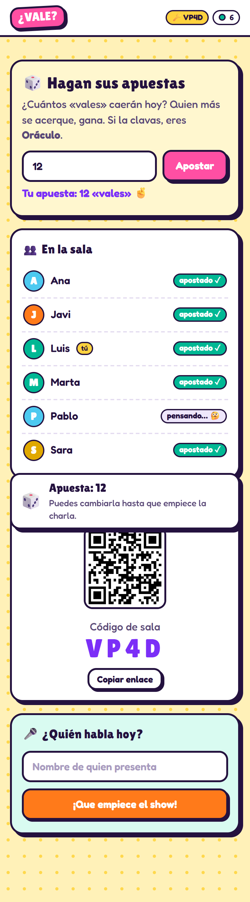
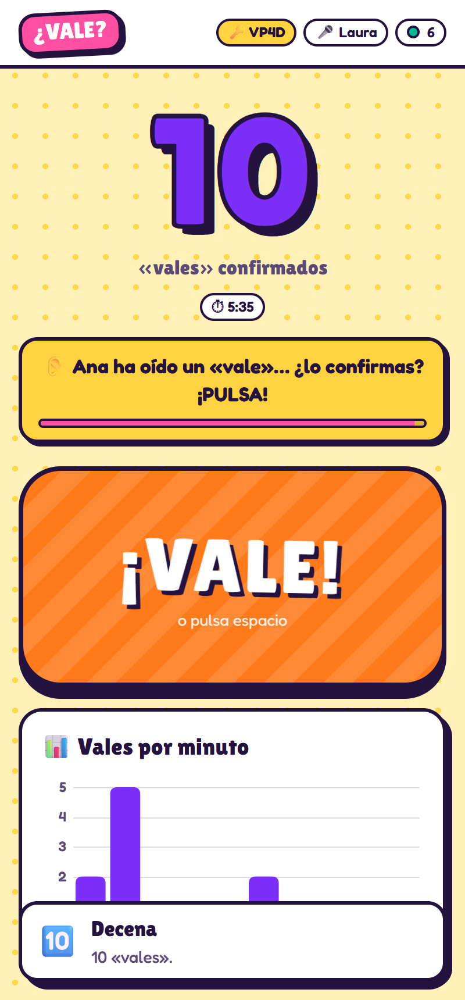
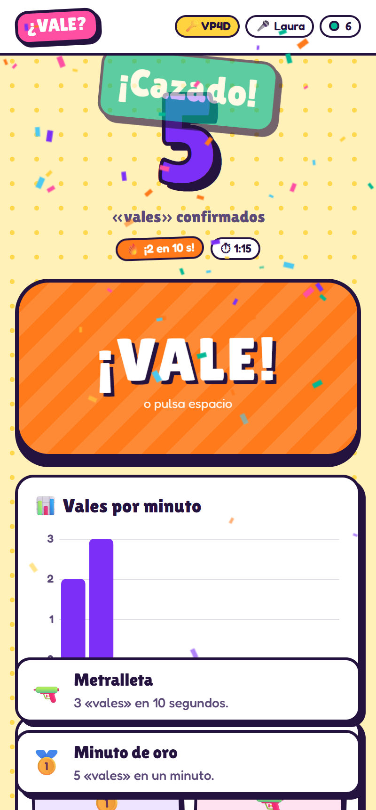
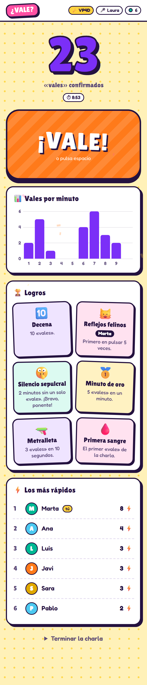
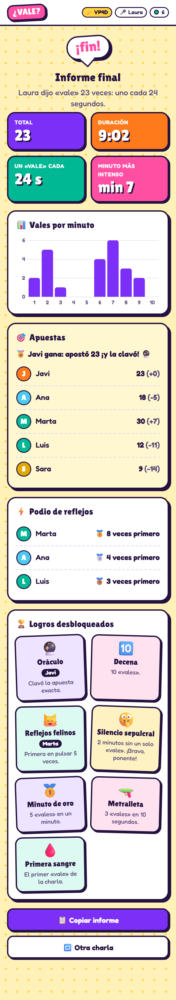
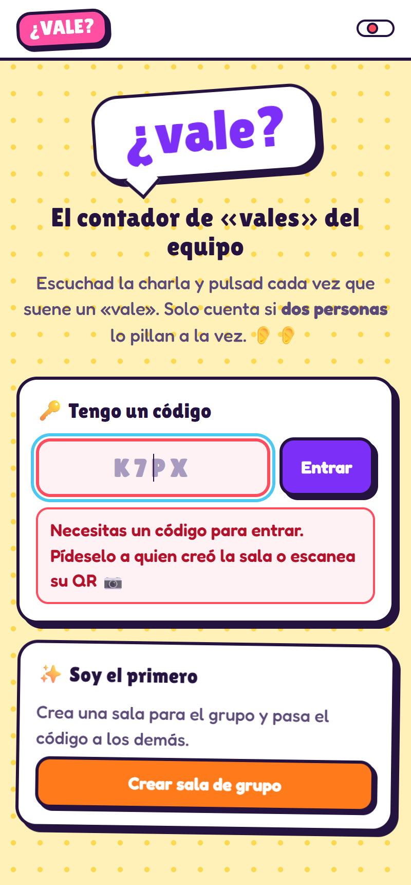
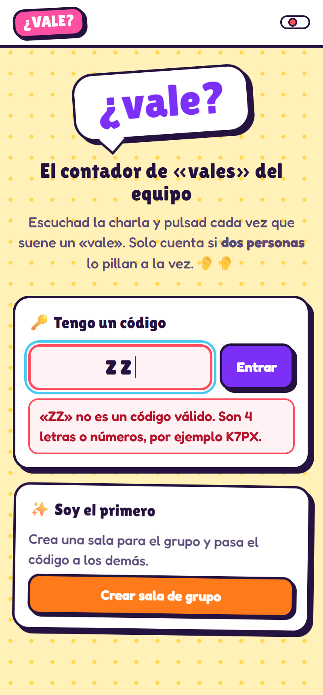
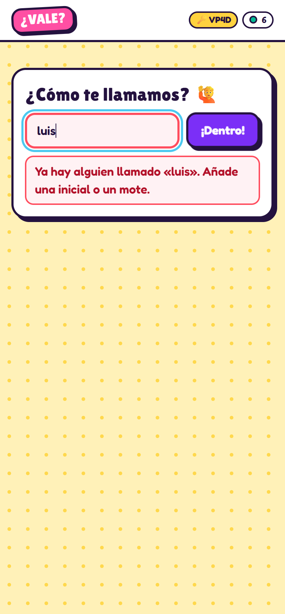

# VALEcounter 🎤

**▶️ Jugar ahora: https://aluonam.github.io/VALEcounter/**

Contador colaborativo, en tiempo real, de las veces que un ponente dice **«vale»**.
Pensado para equipos de unas 10 personas, cada uno con su móvil. No hace falta proyector ni cuenta.

> 🤝 **Sin ánimo de ofender.** VALEcounter es un juego interno para reírnos juntos y reforzar la unión y la cohesión del equipo. No pretende juzgar ni ridiculizar a nadie: todos tenemos muletillas, y «vale» es de las más simpáticas.

## Cómo se juega

1. **Cualquiera del grupo** abre la web y pulsa *Crear sala de grupo*. Sale un código de 4 caracteres y un QR.
2. **El resto** escanea el QR o escribe el código, pone su nombre y **apuesta** cuántos «vales» caerán.
3. Cuando arranca la charla, cualquiera pulsa **¡Que empiece el show!** El ponente no necesita hacer nada: lo que cuenta es quién caza cada «vale».
4. Cada vez que oyes un «vale», pulsas el botón gigante (o la barra espaciadora).
   **Solo cuenta si al menos 2 personas pulsan en menos de 2 segundos.** Así se evitan los graciosos.
5. Al terminar, o como mucho a las **2 h 10 min**, que se cierra sola, se genera un **informe final** que se puede copiar en Markdown y pegar en Slack, Teams o el README.

## Partida de muestra

Seis compañeros, una charla de 9 minutos y 23 «vales». Capturas generadas automáticamente en [`docs/demo`](docs/demo).

| Apuestas | Alguien lo ha oído | ¡Metralleta! |
|---|---|---|
|  |  |  |

| En directo | Informe final |
|---|---|
|  |  |

Mensajes de error:

| Sin código | Código inválido | La sala no existe | Nombre repetido |
|---|---|---|---|
|  |  |  |  |

## Qué tiene

- **Salir**: el botón 🚪 de la cabecera te saca de la sala para crear o entrar en otra. Cada pestaña es una persona distinta, así que se puede probar con varias pestañas del mismo navegador.

- **Consenso**: un «vale» necesita 2 pulsaciones de personas distintas en 2 s. Aviso en vivo de «Fulano ha oído un vale, ¿lo confirmas?».
- **Apuestas previas**: gana quien más se acerque. Si alguien la clava, desbloquea *Oráculo*.
- **Rachas y logros**: Primera sangre, Metralleta (3 en 10 s), Minuto de oro (5 en un minuto), Decena, Medio centenar, Centenar, Silencio sepulcral (2 min sin «vales»), Reflejos felinos (primero en pulsar 5 veces).
- **Gráfica en vivo** de «vales» por minuto.
- **Podio de reflejos**: quién pulsa primero más veces.
- **Informe final** con total, duración, ritmo, minuto más intenso, apuestas, podio y logros.

## Cómo funciona por dentro

Web 100 % estática en JavaScript puro, sin backend ni base de datos.

- El móvil de quien crea la sala ejecuta el juego ([`public/game.js`](public/game.js)) y reparte el estado. En pantalla juega como uno más.
- Los demás se conectan a él por dos vías a la vez: WebRTC directo con [PeerJS](https://peerjs.com/) y, como respaldo, un relé MQTT público sobre WebSocket seguro (HiveMQ y EMQX). Si una red bloquea la conexión directa, todo sigue por el relé. Los mensajes llevan número de orden para no contar nada dos veces.
- Diagnóstico: añade `?debug` a la URL y mira la consola del navegador.
- Los mensajes del relé pasan por servidores públicos: solo contienen nombres y pulsaciones, nada sensible.
- El estado se guarda en el `localStorage` de ese móvil: si recarga la página, la partida sigue y los demás se reconectan solos.

> ⚠️ Quien crea la sala no debe cerrar la pestaña hasta el informe final. La app le avisa.
> Quien crea la sala debe tener la pantalla encendida y la app delante: si el móvil se bloquea, la sala se congela. La app pide al móvil que no apague la pantalla.

## Desarrollo

```bash
npm start   # sirve public/ en http://localhost:3000
npm test    # pruebas de la lógica del juego
```

Despliegue: cualquier hosting estático. Está publicado en GitHub Pages desde la rama `gh-pages`, que contiene `public/`:

```bash
git subtree split --prefix public -b tmp && git push -f origin tmp:gh-pages && git branch -D tmp
```

En Vercel basta con `vercel deploy --prod` (usa `vercel.json`).

Parámetros del juego en `public/game.js` (`DEFAULTS`): personas para consenso, ventana, cooldown y tiempo de silencio.

## Ideas para contribuir

Cada persona del equipo puede llevarse una:

- 🔊 Sonidos personalizados por logro.
- 🃏 Bingo de muletillas («o sea», «¿no?», «básicamente»).
- 🏛️ Hall of fame histórico por participante.
- 📈 Comparativa entre charlas de la misma persona para ver si mejora.
- 🌗 Modo claro.
- 📤 Exportar el informe como imagen para compartir.

## Licencia

MIT
